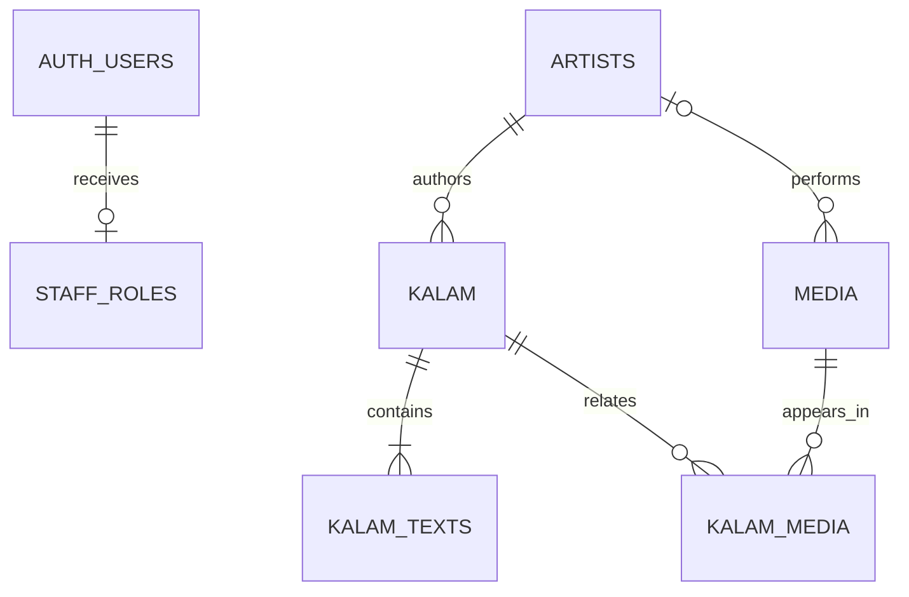

# Architecture and implementation boundaries

## Pages

| Route                                             | Purpose                                                      |
| ------------------------------------------------- | ------------------------------------------------------------ |
| `/`                                               | Literary discovery homepage                                  |
| `/catalogue?q=&form=&page=`                       | Search, literary form filter, 24 works per page              |
| `/kalam/[slug]`                                   | Four-script reader, credits, source notes and attached media |
| `/artists`, `/artists/[slug]`                     | Published profiles, authored works, credited performances    |
| `/media?kind=audio` or `video`                    | Published recordings and accessible players                  |
| `/login`                                          | Staff password sign-in and setup state                       |
| `/admin`                                          | Role-protected counts and editorial navigation               |
| `/admin/kalam`, `/admin/kalam/[id]`               | Work listing and multilingual CRUD; `new` creates            |
| `/admin/artists`, `/admin/artists/[id]`           | Profile listing and CRUD                                     |
| `/admin/media`, `/admin/media/[id]`               | Recording listing and CRUD                                   |
| `/sitemap.xml`, `/robots.txt`, `/opengraph-image` | Search and sharing metadata                                  |

## Database

`artists`: unique stable slug; default and Urdu names; poet/artist/both role; biography; publication state; rights/source notes; timestamps.

`kalam`: unique slug; required author; ghazal/nazm/sher/rubai/prose; summary; publication state; rights/source notes; timestamps.

`kalam_texts`: composite key `(kalam_id, language)` with one plain-text title/body per Urdu (`ur`), Roman Urdu (`roman`, rendered as `ur-Latn`), Persian (`fa`) or English (`en`). No HTML execution. Titles and bodies must both be present. `save_kalam` requires one to four texts.

`media`: audio/video; direct HTTPS source; captions; transcript; recording language; optional credited performer; publication state; rights/source notes; timestamps.

`kalam_media`: composite work/recording key permits one work to have multiple performances and one recording to relate to several works.

`staff_roles`: Auth user UUID and `admin`/`editor`; API read restricted to the current user; API writes and grants denied. There is no first-signup-is-admin behavior.

Foreign keys restrict deleting a credited author or performer still in use. Removing a work cascades its texts and links, while preserving recordings. Removing a recording removes its links. Slugs are unique but editable; permanent redirects for changed slugs are a later milestone.

## Authorization

| Capability                      | Anonymous / reader | Editor | Administrator |
| ------------------------------- | ------------------ | ------ | ------------- |
| Read published content          | Yes                | Yes    | Yes           |
| Read drafts                     | No                 | Yes    | Yes           |
| Create/edit/delete drafts       | No                 | Yes    | Yes           |
| Change/delete published records | No                 | No     | Yes           |
| Publish                         | No                 | No     | Yes           |
| Assign staff roles through API  | No                 | No     | No            |

All six application tables have RLS. Role assignment lives in a table, rather than user-controlled metadata. The only definer function, `private.staff_role()`, has no arguments, checks the caller's Auth UUID, has an empty search path, and is granted only to authenticated users. It avoids recursive policy lookup and is not in an exposed schema. Other functions are security invoker. Explicit grants revoke accidental default table privileges, including truncate.

Each Server Action verifies the signed-in user using Supabase Auth and rereads the role before writing. Database policies independently enforce the same role boundary. Auth responses are private/no-store. Public data access uses an anonymous client without a staff session, preventing privileged draft reads in public output.

## Writes and consistency

Work, texts and media links save in one invoker function/transaction. Invalid languages, missing related records or policy denials roll back the whole save. Each update/delete includes the last-seen `updated_at` timestamp, preventing silent overwrites after another editor saves. Profile/media CRUD uses equivalent filtered updates and deletes. Native forms retain edited controlled values after a validation response. Source notes are required before publication, as are media transcripts and video caption URLs.

An unpublished author hides dependent work and text from anonymous readers. A work marked published under an unpublished author remains hidden until the profile is published. Recording publication is independent: only published recordings are visible or playable publicly. This permits a recording to be published in the media library before work relationships are curated.

## Search and scale

Search normalizes Unicode, removes Arabic vowel marks/tatweel, folds Arabic yeh/kaf variants, then requires each query term to appear in text, title, summary or poet name. SQL parameters remain data. Database search returns a table-valued result, allowing PostgREST to embed the author, scripts and recordings under RLS. The preview uses a matching JavaScript normalization strategy.

The current substring search scans normalized content. Before a large archive, measure real multilingual queries and add a suitable trigram/PGroonga index and ranking. Existing foreign key/publication/order indexes support relationships and listings; they do not claim to index substring search.

Initial limits: catalogue 24 works/page, up to 1,000 pages; public artist directory 200; media library 48; profile-authored work listing 24; profile performances 48; admin lists 200; editor choices 500. Add full directory/media/admin pagination and indexed selectors before exceeding these limits. The sitemap currently covers up to 24,000 works and 200 artist profiles; shard it before growing further. Fine-grained query performance, load testing, revision history and audit logging are future work.

## Sequence after this handoff

1. Connect a dedicated Supabase project, apply schema, bootstrap staff and verify the hosted Auth/PostgREST path.
2. Curate permission-cleared literature, author biographies, translations and licensed recordings with accurate transcripts/captions.
3. Add storage/direct upload, validation/transcoding and a media processing queue.
4. Introduce collections, bookmarks/member accounts, submission review and durable editorial version history.
5. Expand search and pagination; add recovery/onboarding, monitoring, backups and production accessibility review.
6. Publish to a separate Sukhan hosting project, verify the live domain, then add consent-aware analytics and marketing integrations if desired.

## Implementation references

- [Next.js App Router](https://nextjs.org/docs/app) and version-matched docs in the installed framework package.
- [Supabase SSR clients and identity verification](https://supabase.com/docs/guides/auth/server-side/creating-a-client).
- [Supabase Row Level Security](https://supabase.com/docs/guides/database/postgres/row-level-security).
